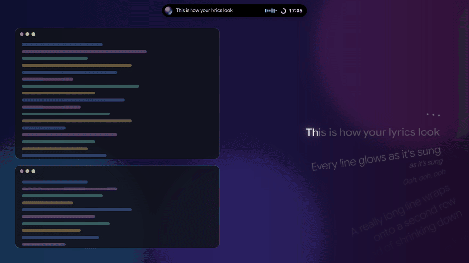
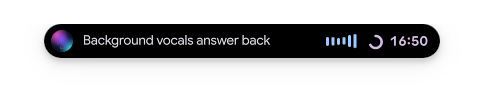
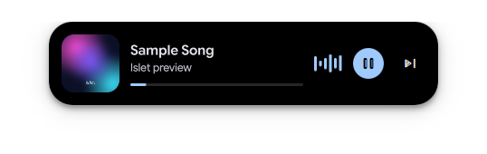
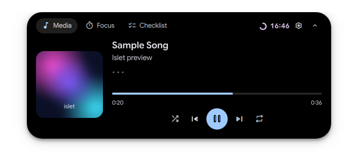
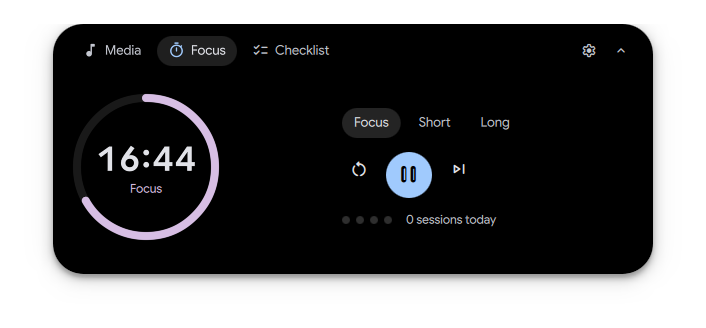
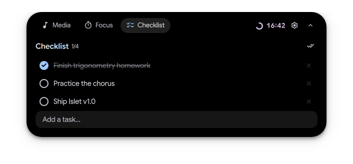
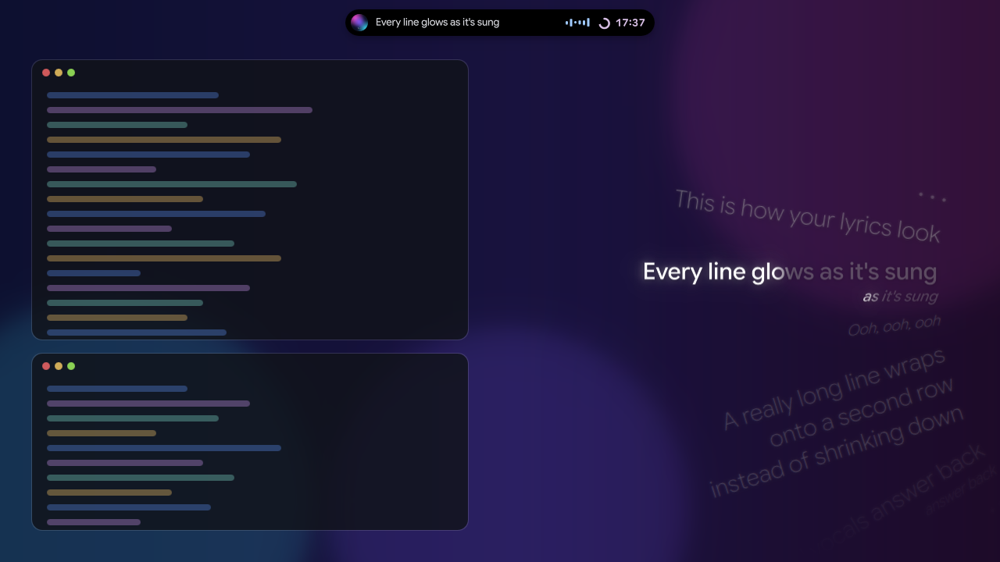
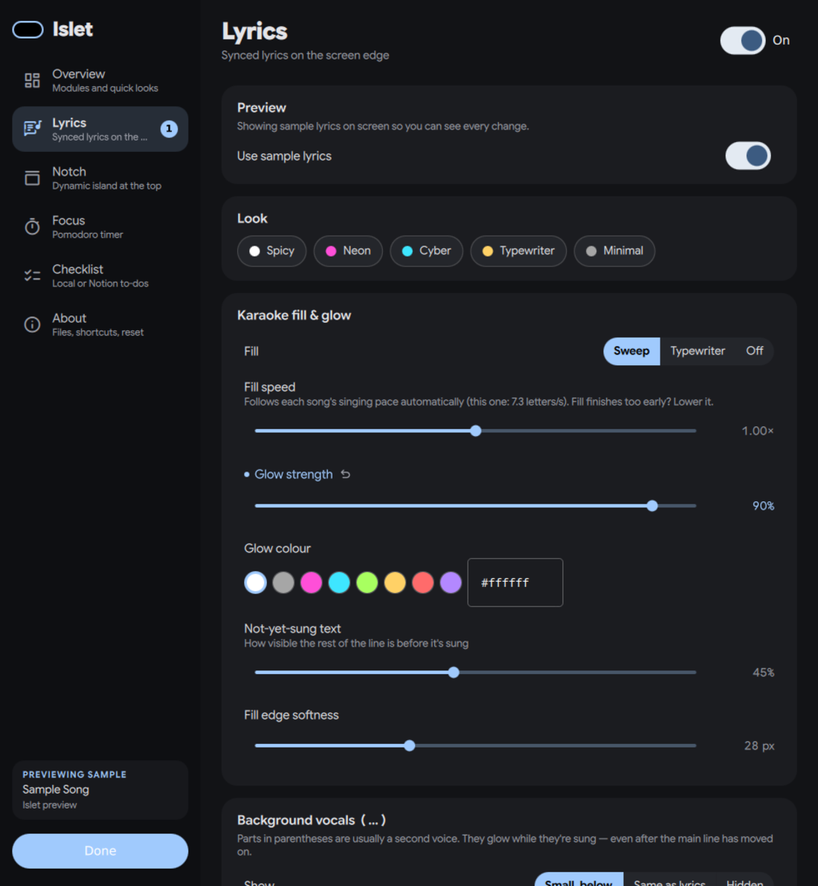

<div align="center">

# 🏝️ Islet

### The open-source Notchy alternative for Linux

A dynamic-island notch, synced karaoke lyrics, a Pomodoro timer and a Notion checklist —
for niri, Hyprland, Sway, KDE Plasma and any Wayland compositor with layer-shell.

[](LICENSE)
[](https://quickshell.org)
[](#-requirements)
[](https://github.com/AvengeMedia/DankMaterialShell)



**[Install](#-install) · [Update](#-updating) · [Features](#-features) · [Ask your AI agent](#-let-your-ai-agent-install-it) · [Settings](#-settings) · [FAQ](#-faq)**

</div>

---

## ⚡ Install

```sh
curl -fsSL https://raw.githubusercontent.com/Claritys11/islet/main/install.sh | sh
```

That's it — Islet starts right away and with every login. No sudo, no build step, nothing touched
outside your home folder. Open **Islet Settings** from your app launcher to make it yours.
A short **setup guide** opens the first time (Spotify or YouTube? bar or floating island? which look?) — run it
again any time with `islet setup`.

<details>
<summary>Other ways to install</summary>

**From a clone** (good for hacking on it — edits apply live):

```sh
git clone https://github.com/Claritys11/islet ~/.local/src/islet
~/.local/src/islet/install.sh --enable
```

**Arch / CachyOS (PKGBUILD)**: `cd packaging/arch && makepkg -si`, then
`systemctl --user enable --now islet`.

**Uninstall**: `~/.local/share/islet/uninstall.sh`

</details>

### 🤖 Let your AI agent install it

Using Claude Code, Codex, Cursor or another coding agent? Paste this:

> Install Islet from https://github.com/Claritys11/islet by following its AGENTS.md. Check my system
> first, verify it's running at the end, and ask me before adding keybinds to my compositor config.

[`AGENTS.md`](AGENTS.md) gives the agent exact, verifiable steps — requirements per distro, install,
health checks, and keybinds for niri, Hyprland and Sway.

### 📋 Requirements

| | |
|---|---|
| **Desktop** | Wayland with layer-shell: **niri, Hyprland, Sway, KDE Plasma, river, Wayfire, labwc** |
| **Quickshell** | 0.2 or newer — `pacman -S quickshell` (already there if you use DankMaterialShell) |
| **Music** | Spotify desktop or any [MPRIS](https://specifications.freedesktop.org/mpris-spec/latest/) player (browsers, mpv, Tidal-hifi, …) |
| Optional | [`cava`](https://github.com/karlstav/cava) for a real audio visualizer · [`fd`](https://github.com/sharkdp/fd) and [`fzf`](https://github.com/junegunn/fzf) for Finder |

> **Windows, macOS, GNOME?** Islet is built on Quickshell, which only runs on Linux Wayland compositors
> that support layer-shell — GNOME, X11, Windows and macOS can't host it. On macOS, try
> [Notchy](https://notchy.dev) itself.

---

## 🔄 Updating

Islet checks GitHub for a new version every few hours and lets you know with a notification.
Updating takes one click or one command — your settings, tasks and focus history are kept.

**From the app:** open **Islet Settings** → an *Update available* card shows what's new → **Update now**.
Islet restarts by itself and a notification says when it's done.

**From a terminal:**

```sh
islet update            # download, apply and restart
islet update --check    # only show what's new
```

`islet update` takes care of everything else too: it reloads the DankMaterialShell bar widget if it
changed, refreshes the Spicy Lyrics bridge (it tells you when to run `spicetify apply`), and stops
safely if you've edited Islet's files yourself. Installed with the PKGBUILD instead? Update with
`makepkg -si` from a fresh checkout. Don't want the automatic check? Turn off
*Settings → About → Check for updates automatically*.

## ✨ Features

### 🏝️ The notch

A dynamic island at the top of your screen, in the spirit of [Notchy](https://notchy.dev).

| Live activities | Hover to peek |
|:---:|:---:|
|  |  |
| Artwork, the line being sung, an audio visualizer and your timer — side by side | Now playing with play/pause and skip, without opening anything |

| 🎵 Media | ⏱️ Focus | ✅ Checklist |
|:---:|:---:|:---:|
|  |  |  |
| Scrubber, shuffle, repeat, and the current lyric with karaoke fill | Pomodoro with short & long breaks, a continuous mode, pause clock, elapsed and focused-time stats | Saved on your computer — or **synced with a Notion page** |

Click the pill to open it. It follows your DankMaterialShell / Matugen wallpaper colours, or stays pure black.

- **📥 Shelf** — drop files on the notch (or on the Islet pill in your DMS bar) to keep them close, then drag
  them out into any app. Files stay where they are; the shelf only remembers them.
- **🌙 Visualizer mode** — step away while music plays and the notch becomes a big audio visualizer; touch
  anything and it's back. Fullscreen videos (idle inhibitors) are respected. `islet notch viz` toggles it by hand.
- **🌤️ Weather** in the pill when nothing plays — from Open-Meteo, for your city or DankMaterialShell's weather
  location. Never looked up from your IP.
- **🧘 Break tips** — each break suggests something good to do with it: stretch, water, rest your eyes…
- **📸 Share card** — the ⬆ button in Media (or `islet share`) makes a 1080×1080 picture of the song and a lyric
  line: pick the line, then copy it or save it to `~/Pictures/Islet`.

### 🎤 Karaoke lyrics, everywhere



- **Synced lyrics** for whatever is playing — Spotify, **YouTube Music or YouTube in your browser**, mpv, VLC… — from the free and open [LRCLIB](https://lrclib.net), no API keys needed. Video titles like *Artist - Song (Official Video)* or channels like *ArtistVEVO* are tidied up before searching
- **🌶️ Spicy Lyrics timing** — already using [Spicy Lyrics](https://github.com/Spikerko/spicy-lyrics)? One command makes Islet show the *same* syllable-by-syllable lyrics, on Spotify's exact clock ([details](#-spicy-lyrics-integration))
- **Visible on every workspace** — it lives on the screen, not on a workspace
- **Karaoke fill** that glows as each line is sung (sweep or typewriter), inspired by [Spicy Lyrics](https://github.com/Spikerko/spicy-lyrics)
- **Follows the singer**: the fill speed is measured from each song's own timing, so ballads and rap both feel right
- **Background vocals** `( … )` appear smaller under the line, and keep glowing while they're still being sung
- **Long lines wrap** into balanced rows; the curved wheel is a port of [React Bits' OptionWheel](https://reactbits.dev/components/option-wheel)
- **Your area, your edges** — choose width, height and position; lines fade out softly instead of being cut
- **Right version, right timing** — when LRCLIB has several versions (album, live, radio edit), Islet picks the one matching your song, and you can switch with one click

### 🧩 Settings



Everything is live, and Islet shows you exactly what you changed:

- **Search** — type what you want in plain words (*youtube*, *too fast*, *weather*, *bar*) and Islet answers and
  jumps to the right setting. From a terminal: `islet settings youtube`
- **Test with sample lyrics** — a switch in the corner turns test mode on or off at any time

- **A toast on screen** names every change and its new value
- **Changed settings** are marked, with a one-click reset; the sidebar counts changes per module
- **See it while you tune it** — the lyrics area is outlined on screen, sample lyrics play when nothing
  else is, and notch size changes open the notch
- **Presets**: Spicy · Neon · Cyber · Typewriter · Minimal

Prefer the terminal? `islet set glow 0.9`, `islet get offsetMs`. Settings live in
`~/.config/islet/config.json` (hand edits reload instantly).

---

## 📅 Hari ini — lessons, deadlines, Google Calendar

The notch's **Hari ini** tab shows today's lessons (the current one marked *sekarang*) next to the
deadlines that are close — from your **Notion** timetable and task list, plus Google Classroom
assignments. Tick a deadline to mark it Done in Notion; type in *＋ Tugas baru* to add one.

- **Two-way sync with Google Calendar**: each lesson becomes a weekly event, each task with a plan date
  an event. Move one in Google Calendar and Notion follows, and the other way round. If the same thing
  changed on both sides between two syncs, the later change wins and you're told (with a button to take
  the other version back).
- **No extra Google login**: Islet goes through [Dank Calendar](https://github.com/AvengeMedia/dankcalendar) (`dcal`),
  which is already signed in. Islet only ever touches events it made.
- **Hard to forget**: the pill says *KKA · mulai 5 mnt lagi* before a lesson and shows deadlines due
  today; the notch opens to Hari ini at your first activity each morning; a nudge comes 3 hours before a
  deadline with a time.

Set it up in *Settings → Calendar & Notion*: Islet finds your timetable and task databases and their
columns by itself (fix them there if it guessed wrong), shows what the first sync will create, and
starts only when you press **Confirm**. It uses the same Notion integration as the Checklist — share
your Notion page with it (••• → Connections).

```
islet today                 what Islet sees (Notion, Dank Calendar, sync)
islet today list            today's lessons and deadlines
islet today add "Laporan"   a new task in Notion
islet today preview|sync    what the next sync would do / sync now
islet notch today           open the tab
```

---

## 🔎 Finder

Find any file or folder from the notch, Listary-style. Press **Mod+G** (or run `islet find`), type part of
a name — `isw` finds `islet-windows`, `lyrics qml` finds `LyricsService.qml` — and pick a result:

| Key | Does |
|---|---|
| **Enter** | folder → your file manager (Dolphin…), file → its default app |
| **Ctrl+T** | a terminal in that folder (Ghostty, kitty, foot, Alacritty, Konsole…) |
| **Ctrl+E** | open it in your editor (VS Code, VSCodium, Zed) |
| **Alt+Enter** | the folder that contains it |
| **Ctrl+C** | copy the path |

Project folders (with `.git`) and the things you open often come first; with nothing typed you see what
you opened lately. Islet keeps its own index of your home (built with `fd`, searched with `fzf`), refreshed
every 10 minutes — junk like `node_modules`, `venv`, Go's module cache and hidden files is skipped.

*Settings → Finder* sets the folders to search, what to skip, and which apps open things; **Set it up**
adds the Mod+G shortcut to niri for you (`islet find --bind`). Other compositors: bind a key to `islet find`.

---

## ⌨️ Command line & keybinds

```
islet setup                                     the setup guide
islet settings [page | words]                   open settings, on a page or searching: islet settings youtube
islet notch [media|focus|checklist|shelf|today|viz]   toggle the notch / open a tab / visualizer
islet today [list|add text|preview|sync]        lessons and deadlines (Notion ⇄ Google Calendar)
islet find [text]                               Finder (also: --open/--copy text, --print text, --reindex, --status, --bind)
islet shelf [FILE…|clear]                       put files on the shelf (no files = list)
islet share [copy|save]                         share card of the song playing now
islet toggle | show | hide                      the lyrics overlay
islet pomodoro [toggle|reset|resetpause|skip|status]
islet todo "Buy milk"                           add a task (no text = list them)
islet set <key> <value> · islet get <key>
islet dms [install|uninstall|status]            Islet in the DankMaterialShell bar
islet spicetify [install|uninstall|status]      Spicy Lyrics lyrics & timing
islet status · islet refetch · islet update [--check] · islet start|stop|restart
```

<details>
<summary><b>niri</b></summary>

```kdl
binds {
    Mod+Shift+L { spawn "islet" "toggle"; }
    Mod+Ctrl+L  { spawn "islet" "settings"; }
    Mod+N       { spawn "islet" "notch"; }
    Mod+Alt+P   { spawn "islet" "pomodoro" "toggle"; }
    Mod+G       { spawn "islet" "find"; }
}

window-rule {
    match title="^Islet Settings$"
    open-floating true
}
```
</details>

<details>
<summary><b>Hyprland</b></summary>

```
bind = SUPER SHIFT, L, exec, islet toggle
bind = SUPER, N, exec, islet notch
bind = SUPER ALT, P, exec, islet pomodoro toggle
bind = SUPER, G, exec, islet find
windowrulev2 = float, title:^(Islet Settings)$
```
</details>

<details>
<summary><b>Sway</b></summary>

```
bindsym $mod+Shift+l exec islet toggle
bindsym $mod+n exec islet notch
bindsym $mod+g exec islet find
for_window [title="^Islet Settings$"] floating enable
```
</details>

<details>
<summary><b>KDE Plasma</b></summary>

System Settings → Keyboard → Shortcuts → **Add New → Command or Script**, e.g. `islet notch`.
</details>

---

## 🧩 DankMaterialShell bar

Prefer Islet in your bar instead of a floating notch? On DankMaterialShell:

```sh
islet dms
```

This adds the **Islet Media** plugin to DMS and puts it where DMS's own media widget was (your old
settings are backed up to `settings.json.islet-backup`). The bar pill shows the artwork, the lyric being
sung with its karaoke fill, the visualizer and your focus timer, all in your DMS theme.
**Left click** drops Islet's Media / Focus / Checklist island right under it; **right click** plays/pauses.
Islet's own floating pill goes away.

Undo with `islet dms uninstall`. Width, visualizer and timer are under **Settings → Notch → Bar widget**.
Works with top bars; the widget talks to Islet over `$XDG_RUNTIME_DIR/islet.sock`, so other shells can
integrate the same way (see `IsletLink.qml`).

## 🌶 Spicy Lyrics integration

[Spicy Lyrics](https://github.com/Spikerko/spicy-lyrics) looks perfectly in time because it has
**syllable-synced lyrics** and reads **Spotify's own playback clock** from inside the app. If you use it
with [Spicetify](https://spicetify.app), Islet can use exactly the same:

```sh
islet spicetify      # installs the Islet Bridge extension and runs `spicetify apply` (Spotify restarts)
```

The small **Islet Bridge** extension reads the lyrics Spicy Lyrics has *already* loaded and samples the
playback position the same way Spicy Lyrics does, then hands both to Islet on `127.0.0.1`. It never
contacts Spicy Lyrics' servers itself, and nothing leaves your computer. Islet applies Spicy Lyrics'
clock smoothing and +100 ms latency lead, so the glow fills each syllable as it's sung — background vocals
included.

Songs Spicy Lyrics doesn't have fall back to LRCLIB automatically. See the status under
**Settings → Lyrics → Source & timing**, or run `islet spicetify status`. Requires `python3` (used for the
tiny local receiver). Remove with `islet spicetify uninstall`.

## 📝 Notion checklist

1. Create an integration at [notion.so/profile/integrations](https://www.notion.so/profile/integrations) and copy its **Internal Integration Secret**.
2. Open the Notion page with your checklist → **•••** → **Connections** → add the integration.
3. In **Islet Settings → Checklist**, choose **Notion**, paste the secret and the page link, press **Test connection**.

Every to-do block on that page appears in the notch; ticking, adding and deleting sync back. The secret
stays on your computer (`~/.config/islet/notion-token`, readable only by you).

---

## 🍏 Coming from Notchy?

Islet is young and focused. Here's what carries over today:

| Notchy | Islet |
|---|---|
| Live activities on the closed notch | ✅ Music + lyric + visualizer, focus timer |
| Hover peek, click to open | ✅ |
| Media controls, scrubbing, shuffle, repeat | ✅ |
| Time-synced lyrics via LRCLIB | ✅ Plus syllable-synced lyrics from Spicy Lyrics, and a karaoke overlay on the screen edge |
| Audio spectrum visualizer | ✅ via cava |
| Pomodoro focus sessions | ✅ |
| Quick notes / reminders | ✅ Checklist, local or Notion |
| Notch or pill shape, adjustable size | ✅ |
| Clipboard history, file shelf, HUDs, weather, calendar… | 🔜 Not yet — [ideas welcome](https://github.com/Claritys11/islet/issues/new?template=feature_request.yml) |

---

## ❓ FAQ

<details>
<summary><b>Lyrics are out of sync</b></summary>

Using Spotify with Spicetify + Spicy Lyrics? Run `islet spicetify` — Islet then uses Spicy Lyrics'
syllable timing and Spotify's own clock. Otherwise: LRCLIB often has several versions of a song. Open **Settings → Lyrics → Lyrics version for this song**,
press **Find versions** and pick one whose length shows in green. If the *fill* runs ahead or behind the
singer, adjust **Fill speed**; for a constant delay, use **Timing offset**.
</details>

<details>
<summary><b>"No lyrics found"</b></summary>

LRCLIB doesn't have the song yet — you can add it at [lrclib.net](https://lrclib.net) and everyone benefits.
"Couldn't reach LRCLIB" means the free server is busy; Islet retries by itself.
</details>

<details>
<summary><b>Nothing shows up</b></summary>

Run `islet status` and `journalctl --user -u islet -n 50`. Check your player appears in `playerctl -l`,
and that your desktop supports layer-shell (GNOME doesn't).
</details>

<details>
<summary><b>Does it slow my computer down?</b></summary>

Islet renders only what's visible and idles when nothing plays. The visualizer runs only while music is playing.
</details>

<details>
<summary><b>I used lyrics-wheel</b></summary>

That was Islet's old name. Run the installer again: it removes the old install and your settings,
tasks and Notion secret come along automatically.
</details>

---

## 🤝 Contributing

Islet is plain QML — no build step, hot reload on save. See [CONTRIBUTING.md](CONTRIBUTING.md).
The screenshots and GIF above are rendered from the real components with `tools/make-media.sh`.

## 💜 Credits

Curved wheel from [React Bits](https://reactbits.dev) (MIT) · karaoke look inspired by
[Spicy Lyrics](https://github.com/Spikerko/spicy-lyrics) · notch inspired by [Notchy](https://notchy.dev) ·
lyrics by the [LRCLIB](https://lrclib.net) community · built on [Quickshell](https://quickshell.org).

[MIT License](LICENSE)
